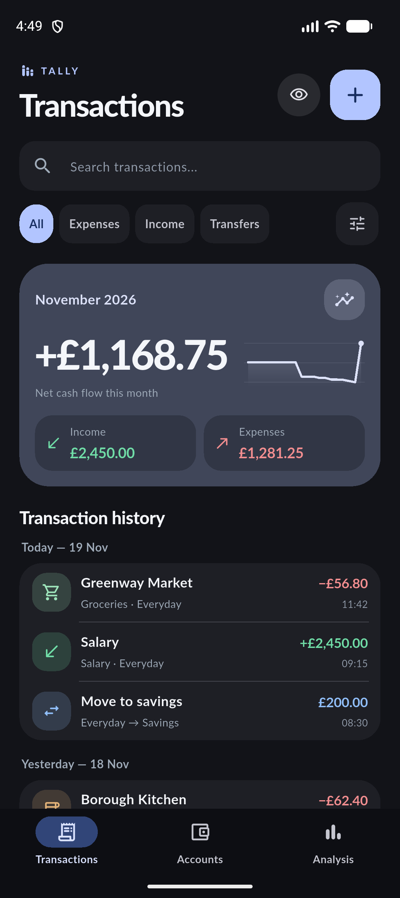
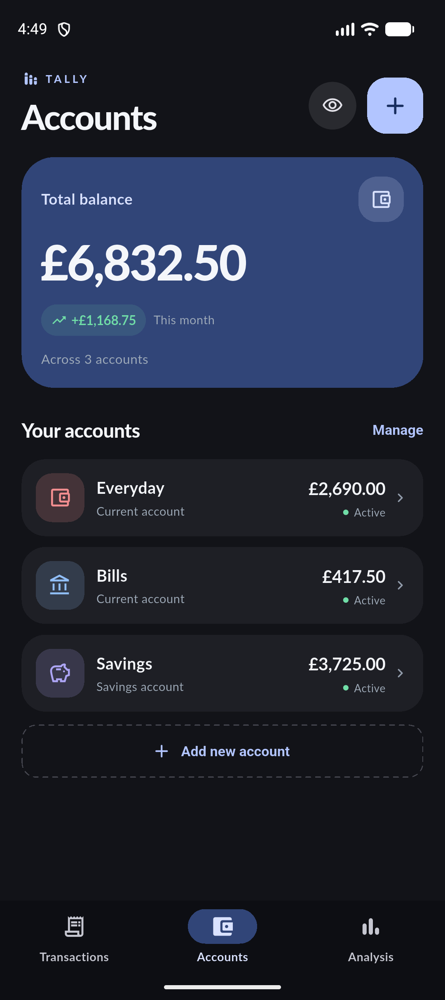
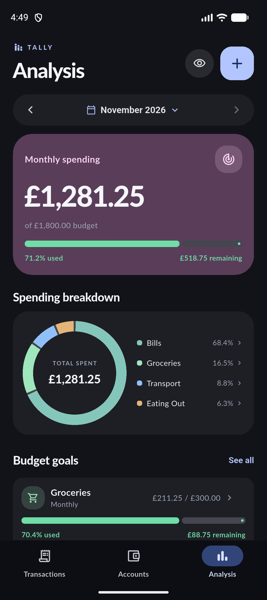

# Tally

Tally is an Android-first Flutter app for tracking personal finances in pounds sterling. It keeps a local ledger of accounts, transactions, and spending goals. A new installation starts with an empty ledger.

## Screenshots

<p>
  
  
  
</p>

Screenshots captured on Android with sample data.

## Install on Android

1. Download the APK from the [latest Tally release](https://github.com/Kesara-Technologies/tally/releases/latest).
2. Copy the APK to your phone if you downloaded it elsewhere, then open it and follow Android's installation prompts.
3. Open **Tally**. In **Accounts**, use **+** to create your first account and enter its opening balance.

The APK supports Android 7.0 (API 24) and later on ARM64, 32-bit ARM, and x86-64 devices. It is a release build signed with a development key for direct installation.

## Use Tally

- **Transactions** lets you add expenses, income, and transfers, or search and filter your history. Itemise purchases when you want parts of one expense to count toward different spending categories. To credit income to an account without counting it in the monthly cash-flow summary or chart, turn off **Include in net cash flow**.
- **Accounts** shows balances, monthly activity, and account history. Open **Manage** and drag the handles to reorder accounts. Active accounts appear above archived ones. Use **Adjust account balance** to record a correction with a reason.
- **Analysis** breaks down spending by category and month, shows spending trends, and tracks weekly, monthly, and yearly budget goals. Tap the month label to jump to another month or year. Scroll to **Backup & restore** to export or restore the ledger.

On Android 12 and later, Tally follows the system's wallpaper-based colours. Tally's mint palette is the fallback.

## Back up your data

Tally stores financial data on your device. Tap **Analysis → Backup & restore → Export backup** to save a JSON copy of your accounts, transactions, item details, budgets, and balance visibility setting. Keep the file somewhere you can access independently of the app. The JSON contains your financial records in readable form.

To move to a new device or recover a ledger, select **Restore backup** and choose the JSON file. Tally validates the file and shows a confirmation before replacing the current ledger.

## Build and test

The Android build has been verified with Flutter 3.47.9 and Dart 3.13.7. Set up the Android SDK and either start an Android emulator or connect a phone with USB debugging enabled.

```sh
flutter pub get
flutter devices
flutter run -d <android-device-id>
```

Run static analysis and the test suite from the project root.

```sh
flutter analyze
flutter test
```

Build the signed release APK with the project's current development signing configuration.

```sh
flutter build apk --release
```

The build writes the APK to `build/app/outputs/flutter-apk/app-release.apk`. Android updates require an APK signed with the same key as the installed app.

## Source layout

- [`lib/data/`](lib/data/) contains the ledger, financial models, backup format, and storage.
- [`lib/ui/`](lib/ui/) contains the tabs, transaction and account forms, and charts.
- [`test/widget_test.dart`](test/widget_test.dart) covers the ledger and the main app flows.
- [`assets/fonts/Lato-LICENSE.txt`](assets/fonts/Lato-LICENSE.txt) contains the licence for the bundled Lato fonts.
